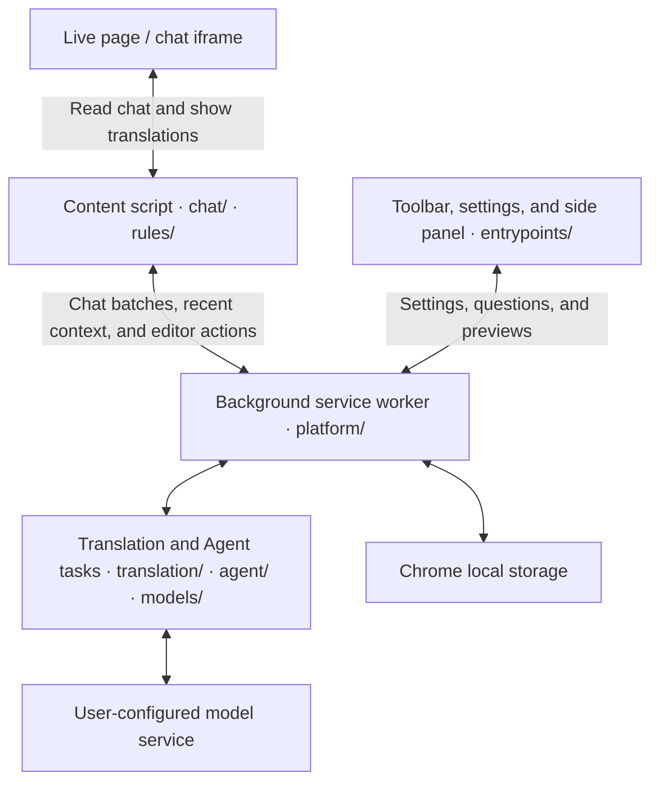

<p align="center"></p>

# LiveChat Copilot

[简体中文](README.md) · **English**

A Chrome extension for following and replying to live chat across languages. It ships with rules for YouTube, Twitch, Bilibili, and Douyu. On other sites, try automatic detection or select the chat region manually.

- **Read chat in your language.** See translations below the original messages and set a target language for each stream.
- **Join the conversation.** Translate your own draft or generate a bilingual reply based on recent chat. Review the result, then copy it or fill a compatible chat input.
- **Ask a question.** Ask about the stream or another topic. The assistant uses recent chat only when the question needs live context.

## Install and get started

Download the Chrome ZIP from **Assets** on [GitHub Releases](https://github.com/xsola/livechat-copilot/releases/latest). Extract it, turn on Developer mode at `chrome://extensions`, and load the folder containing `manifest.json`. Development builds are available on [GitHub Actions](https://github.com/xsola/livechat-copilot/actions/workflows/chrome-build.yml).

To build from source, use Node.js 22.12 or newer. The extension requires desktop Chrome 120 or newer.

```sh
npm ci
npm run build
```

Load `dist/chrome-mv3`. Configure and test your own OpenAI-compatible model in the extension settings, then open a stream and use the toolbar to enable translation or open the assistant.

## Architecture



## Roadmap

Traditional translation APIs, Chrome on-device translation, more built-in site rules, community rule subscriptions, and streamer captions and speech as context.

Further reading in Chinese · [User and developer guide](docs/guide.md) · [Detailed architecture](docs/architecture.md) · [Site rules](docs/rules.md) · [Data handling](docs/privacy.md)

[MPL 2.0](LICENSE)
