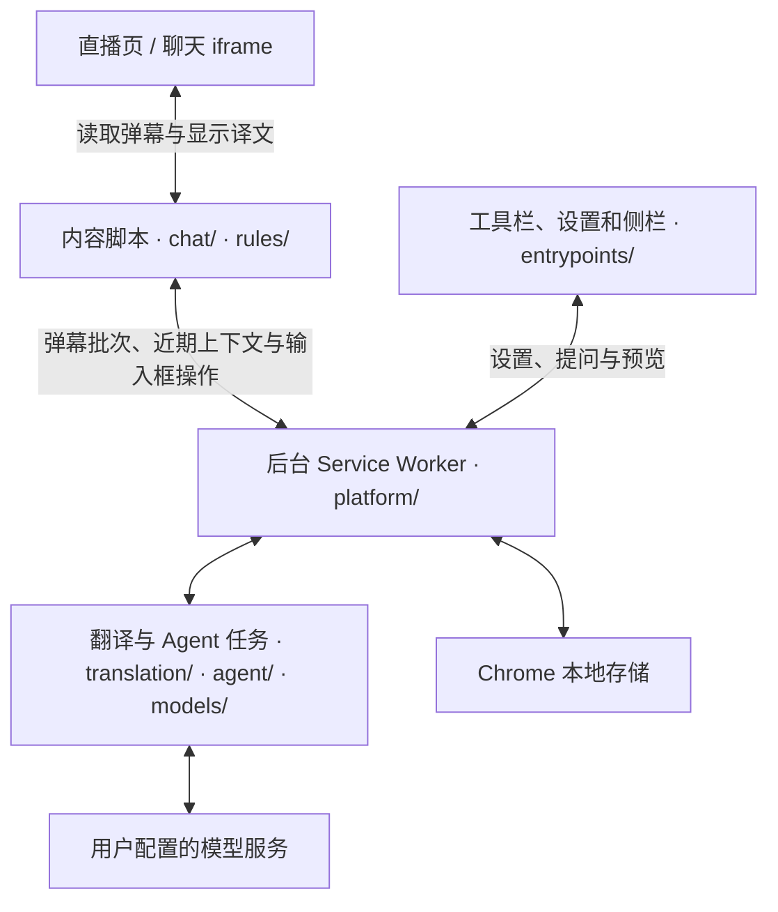

<p align="center"></p>

# LiveChat Copilot

**简体中文** · [English](README.en.md)

Chrome 直播弹幕翻译与回复助手。内置 YouTube、Twitch、Bilibili 和斗鱼弹幕规则，其他站点可尝试自动识别或手动选区。

- **看懂弹幕**。在原消息下方显示译文，每个直播间可单独设置目标语言。
- **参与聊天**。翻译草稿，或根据近期弹幕起草双语回复。确认后可复制或填入兼容的输入框。
- **按需提问**。可问普通问题或直播相关问题，需要直播上下文时才读取近期弹幕。

## 安装与开始使用

在 [GitHub Releases](https://github.com/xsola/livechat-copilot/releases/latest) 的 **Assets** 下载 Chrome ZIP。解压后，在 `chrome://extensions` 开启开发者模式并加载包含 `manifest.json` 的目录。开发构建可在 [GitHub Actions](https://github.com/xsola/livechat-copilot/actions/workflows/chrome-build.yml) 下载。

也可用 Node.js 22.12+ 从源码构建。需要桌面 Chrome 120+。

```sh
npm ci
npm run build
```

加载 `dist/chrome-mv3`。在扩展设置里配置并测试自己的 OpenAI 兼容模型，打开直播后从工具栏启用翻译或打开助手侧栏。

## 代码架构



## 计划功能

传统翻译 API、Chrome 本地翻译、更多站点内置规则、社区规则订阅，以及主播字幕和语音上下文。

[使用与开发指南](docs/guide.md) · [详细架构](docs/architecture.md) · [站点规则](docs/rules.md) · [数据处理说明](docs/privacy.md) · [MPL 2.0](LICENSE)
