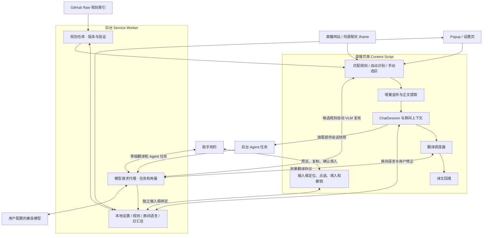

# LiveChat Copilot 代码架构

页面脚本拥有实时 DOM 状态。Service Worker 持有模型访问、社区规则更新和持久化。两者通过 `src/platform/messages.ts` 中的类型和运行时校验传递数据。

## 目录与依赖

| 目录 | 负责什么 |
|---|---|
| `src/entrypoints/` | WXT 的后台、页面脚本、工具栏、设置页和助手侧栏入口 |
| `src/chat/` | 页面路由、自动发现、选区、观察器、会话和渲染 |
| `src/chat/composer/` | 输入框定位、手动选择、高亮、读写及撤销 |
| `src/rules/` | 规则类型、内置规则、解析顺序、候选版本和回退 |
| `src/translation/` | 弹幕调度器、翻译协议和独立的草稿翻译请求 |
| `src/models/` | OpenAI 兼容传输、独立任务的 Prompt 和结果校验 |
| `src/rooms/` | 标题、主播、房间键与语言记忆 |
| `src/agent/` | 组装有界的会话上下文，编排双语回复和弹幕分析 |
| `src/platform/` | Chrome 消息、截图、权限、设置和本地存储 |
| `src/usage/` | 页面事件和模型用量的本地日汇总 |
| `rules/`、`tests/` | 社区规则索引、示例和可重放的页面样本 |

渲染器持有 DOM 引用。调度器和模型接口接收消息数据。模型层和规则仓库分别受各自的 URL 与权限控制。

## 规则和页面生命周期

1. 浏览器将页面脚本注入 YouTube。其他网站从工具栏显式授权，随后为该来源注册脚本。页面脚本检查当前页面与 frame 的匹配范围。
2. 优先检查匹配当前路径的本地规则，再尝试同站其他房间保存的规则，之后检查社区和内置规则。跨房间首次使用前，容器必须唯一、可见，并且能读取至少两条不同的正文。验证通过后在当前会话复用。即使两个房间共用 URL 前缀，也可以分别保存不同的弹幕布局。
3. 新社区版本下载后成为候选。页面观察到足够的正文样本后才激活。若上一规则仍能提取正文而新候选持续失败，新版本被拒绝并保留旧版。安静或尚未加载聊天的页面可以继续等待证据。
4. `MutationObserver` 处理新增、更新和删除。每次有效内容变化获得新的会话内消息 ID。模型结果回来时，页面重新核对节点、正文与 ID，因此切台或虚拟列表复用后的旧译文会被丢弃。
5. 自动识别结合容器语义、重复消息行、正文新增与改写，以及输入框距离、对齐、标签和发送控件。已启用翻译的同站新房间在规则复用失败时，明确的本地候选可以用绿框提示，仍由用户核对后保存。直播页内部导航会清除旧面板和高亮。
6. 开启截图核验后，歧义候选可交给 VLM 比较。后台把最多三组候选裁图按顺序合成一张图，每组对应一个弹幕列表和可选的无草稿输入框。模型返回候选 ID，也可以只确认弹幕区。同一页面会话里可复用已完成的核验结果。

## 翻译、上下文与用量

调度器在页面侧做有界排队、微批、重复文本复用和过期丢弃。点击和可见消息优先。后台代理对多个标签页发来的翻译请求限制总并发，校验来源、设置版本和服务权限，按输入消息 ID 解析响应。缺失的单项结果可以跳过，未知或重复 ID 会拒绝该响应。

模型任务默认请求 JSON 模式。接口明确拒绝该参数时，改用提示词约束输出并继续本地校验 JSON 内容。图片核验的可用性由模型测试和实际接口响应判断，截图传输由独立开关控制。

模型提示词由任务指令和固定输出协议组成。当前站点的任务指令优先于全局指令，设置中的预览与模型调用使用同一组构建函数。页面提取同时保留原始文字和去除表情后的文本，默认选择后者进入翻译队列。

`ChatSession.context()` 提供最近两分钟在页面中观察到的正文。生成回复最多使用 35 条，分析最多使用 60 条。分析任务的每个要点对应样本 ID，后台校验这些 ID 后，侧栏展示对应的原始弹幕。输入框翻译单独调用 Provider，请求只包含草稿和目标语言，直接进入后台模型任务。

侧栏通过后台绑定当前标签页和聊天 frame。模型请求结果先进入侧栏。用户确认填入时，输入框所在 frame 检查页面标识、编辑器节点、草稿状态和输入法状态。填入或撤销之前对原站的可写性进行检查，填入后再确认当前文本。支持基本文本输入框和可安全写入的纯文本编辑器，其他布局可以复制结果。输入框的手动定位规则和房间语言保存在本地，草稿和弹幕快照仅留在当前会话。

房间信息优先从页面公开字段读取。用户点「根据弹幕推断」时，才会请求模型分析房间线索和正文样本。返回的房间语言和基本信息可以复用，手动语言优先。后续字幕或语音转录可作为带时间戳的新上下文来源，接入现有 Agent 任务。
