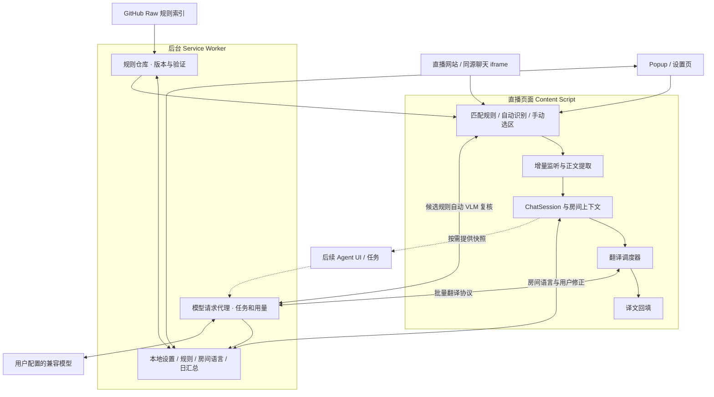

# LiveChat Copilot 代码架构

页面脚本拥有实时 DOM 状态。Service Worker 持有模型访问、社区规则更新和持久化。两者通过 `src/platform/messages.ts` 中的类型和运行时校验传递数据。

## 目录与依赖

| 目录 | 负责什么 |
|---|---|
| `src/entrypoints/` | WXT 的后台、页面脚本、工具栏和设置页入口 |
| `src/chat/` | 页面路由、自动发现、选区、观察器、会话和渲染 |
| `src/rules/` | 规则类型、内置规则、解析顺序、候选版本和回退 |
| `src/translation/` | 调度器和远端翻译请求协议 |
| `src/models/` | OpenAI 兼容传输、独立任务的 Prompt 和结果校验 |
| `src/rooms/` | 标题、主播、房间键与语言记忆 |
| `src/agent/` | 可复用的任务上下文与双语草稿任务 |
| `src/platform/` | Chrome 消息、截图、权限、设置和本地存储 |
| `src/usage/` | 页面事件和模型用量的本地日汇总 |
| `rules/`、`tests/` | 社区规则索引、示例和可重放的页面样本 |

渲染器持有 DOM 引用。调度器和模型接口接收消息数据。模型层和规则仓库分别受各自的 URL 与权限控制。

## 规则和页面生命周期

1. 浏览器将页面脚本注入 YouTube。其他网站从工具栏显式授权，随后为该来源注册脚本。页面脚本检查当前页面与 frame 的匹配范围。
2. 已确认的本地规则优先，接着是社区和内置规则。无可用规则时，自动识别根据容器语义、重复行、正文节点和增量变化给候选排序，展示预览。选区通过 DOM 结构生成可复用选择器。
3. 新社区版本下载后成为候选。页面观察到足够的正文样本后才激活。若上一规则仍能提取正文而新候选持续失败，新版本被拒绝并保留旧版。安静或尚未加载聊天的页面可以继续等待证据。
4. `MutationObserver` 处理新增、更新和删除。每次有效内容变化获得新的会话内消息 ID。模型结果回来时，页面重新核对节点、正文与 ID，因此切台或虚拟列表复用后的旧译文会被丢弃。
5. 开启自动复核后，识别或选区产生的候选规则会自动进入 VLM 复核。后台确认活动标签页，在本地裁剪弹幕区及空的候选发送区，只把裁图、简化结构和少量正文发给模型。同一页面会话里的同一候选可复用已完成的核验结果。模型拒绝图片或页面没有临时截图权限时继续本地预览。新规则仍由用户确认。

## 翻译、上下文与用量

调度器在页面侧做有界排队、微批、重复文本复用和过期丢弃。点击和可见消息优先。后台代理对多个标签页发来的翻译请求限制总并发，校验来源、设置版本和服务权限，按输入消息 ID 解析响应。缺失的单项结果可以跳过，未知或重复 ID 会拒绝该响应。

`ChatSession.context()` 返回近期正文和房间信息。遇到有足够独立样本的新房间，模型综合页面提示和弹幕推断语言，并按房间保存。YouTube 在能取得频道标识时使用频道，弹出聊天窗缺少频道信息时可退回视频 ID。用户可覆盖或清除记忆。当前弹幕只保留在页面会话，历史用量只保留汇总。

双语草稿任务用这份上下文、用户意图和房间语言生成草稿，再返回用户阅读语言的对照。未来主题、风向、情绪及语音转录可以沿用会话数据来源，任务各自选择时间窗和输出协议。
